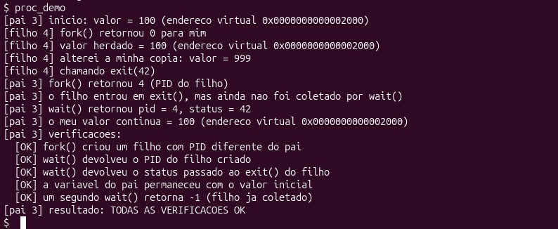
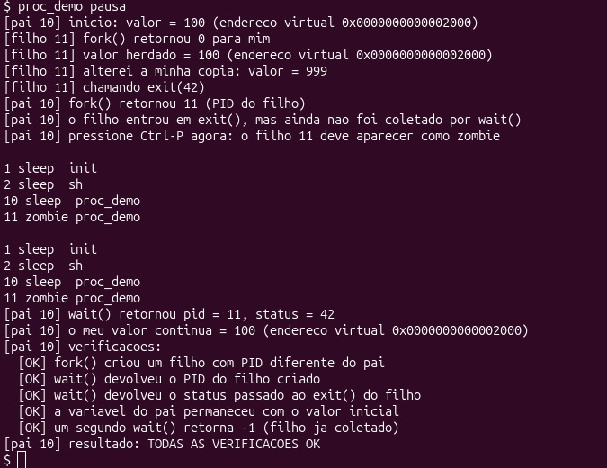
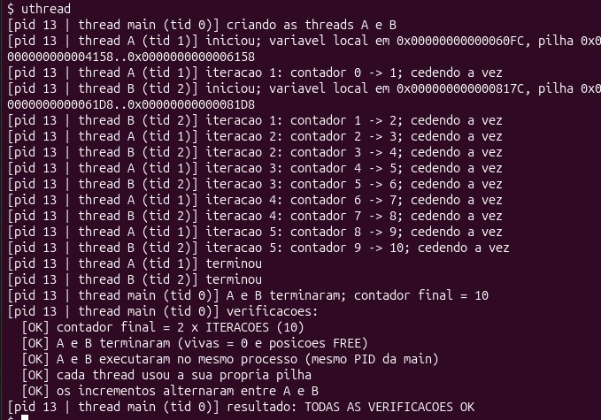

# Reprodução independente por Gabriel Alves Domingos

Registro incorporado em 26/11/2026 a partir de três capturas enviadas por Pedro Brassi Luccas e identificadas por ele como a execução realizada por Gabriel Alves Domingos. Pedro confirmou que a reprodução ocorreu em cópia limpa. A data exata da execução e o log integral dessa sessão não foram informados; 26/11 é a data do registro documental.

## Resultado

A reprodução dos comandos `proc_demo`, `proc_demo pausa` com `Ctrl-P` e `uthread` está confirmada pelas capturas, com as verificações dos programas aprovadas. A preparação em cópia limpa é registrada conforme a confirmação do grupo; as imagens mostram a execução dos programas, sem apresentar os comandos de preparação, a versão do ambiente ou o hash da base dessa sessão.

| Comando | Evidência observada | Resultado |
|---|---|---|
| `proc_demo` | Pai PID 3 e filho PID 4; filho altera 100 para 999 e pai mantém 100; `wait()` retorna PID 4 e status 42; cinco verificações `[OK]`. | Aprovado |
| `proc_demo pausa` + `Ctrl-P` | Pai PID 10 e filho PID 11; a tabela mostra `11 zombie proc_demo` antes da coleta; `wait()` retorna PID 11 e status 42; cinco verificações `[OK]`. | Aprovado |
| `uthread` | `main`, A e B no PID 13; variáveis locais nas faixas das pilhas correspondentes; alternância A/B; contador compartilhado de 0 a 10; término das duas threads e cinco verificações `[OK]`. | Aprovado |

## Capturas originais recebidas

Os arquivos foram copiados sem recorte, retoque ou alteração do conteúdo.

### Processos

### Processo zumbi antes de wait

A captura mostra duas listagens enquanto o filho permanece zumbi. Não há nova listagem de processos após o `wait()` nessa imagem.

### Threads cooperativas de usuário

As threads do experimento usam o modelo N:1: compartilham o processo e alternam cooperativamente. A captura não demonstra execução paralela nem condição de corrida.

## Relação com os demais registros

Este material complementa os [comandos e resultados](comandos-e-resultados.md). Os logs [do experimento de processos](passo3-proc_demo.txt) e [do Uthread e da cópia limpa inicial](passo4-uthread-e-copia-limpa.txt) foram preservados. Eles pertencem às sessões anteriores e não são atribuídos à reprodução do Gabriel.
